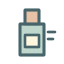

# 高血圧：減塩すれば薬はいらない？

「塩分を減らせば、薬を飲まずに済むのでは？」。薬を勧められたとき、そう考えることはありませんか。

減塩は、血圧を下げるための大切な取り組みです。ただし、<strong>減塩だけで十分な人もいれば、薬を組み合わせる必要がある人もいます。</strong> これからの脳や心臓、腎臓を守るために、自分に合う方法を考えましょう。[1,2]

<aside class="h-keypoints" aria-label="この記事のポイント">

まず知っておきたい、3つのこと

<ul>
<li><strong>減塩は、薬を飲んでいる人にも役立ちます。</strong></li>
<li><strong>血圧の下がり方には個人差があり、減塩だけで十分とは限りません。</strong></li>
<li><strong>血圧が下がっても、薬を自分で減らしたり、やめたりしないでください。</strong> 家庭血圧の記録をもとに相談しましょう。</li>
</ul>
</aside>

## 1．「まずは減塩で頑張りたい」と思ったら

生活を変えて健康を守りたいという気持ちも、薬を飲み続けることへの不安も、医師や薬剤師に伝えてよいことです。

「薬のどんなところが心配か」「食事でどんな工夫をしているか」を話してみましょう。薬が必要になっても、減塩の努力が無駄になるわけではありません。

## 2．減塩は、血圧を下げるための基本

塩分を摂り過ぎると、体に水分がたまりやすくなるなどして、血圧が上がることがあります。高血圧の人では、<strong>1日の食塩摂取量を6g未満にすること</strong>が目標とされています。調味料だけでなく、加工食品や外食に含まれる分も合わせた量です。[1,2]

最初から完璧を目指すより、取り組めそうなことを一つ選びましょう。

<ul class="h-salt-actions" aria-label="今日から選べる4つの減塩の工夫">
<li>
<h3 class="h-salt-label"><strong>麺類の汁</strong></h3>

麺類の汁は、全部飲まない。
</li>
<li>
<h3 class="h-salt-label"><strong>しょうゆ・ソース</strong></h3>

しょうゆやソースは、かける前に味を確かめる。
</li>
<li>
<h3 class="h-salt-label"><strong>献立の組み合わせ</strong></h3>

汁物や漬物、加工食品が重なっていないか見直す。
</li>
<li>
<h3 class="h-salt-label"><strong>食品の表示</strong></h3>

食品の表示にある「食塩相当量」を見て、似た商品を比べる。
</li>
</ul>

食事量そのものを極端に減らす必要はありません。食べにくさや食欲低下がある人は、十分な栄養も摂れるように、医師や管理栄養士に相談してください。

## 3．減塩すると、どれくらい血圧が下がる？

減塩によって、<strong>一般的な降圧薬1剤に匹敵する血圧低下が得られた</strong>という研究報告もあります。2023年の研究では、最初の1週間の終了時、低ナトリウム食の群は高ナトリウム食の群より、24時間測定の上の血圧が平均8mmHg低く、著者らは一般的な第一選択の降圧薬に匹敵する効果と述べています。[3]

ただし、薬と減塩を直接比較した試験ではありません。研究用の食事による短期間の結果であり、誰でも同じだけ下がる、薬1剤を置き換えられるという意味ではありません。減塩は、薬を使っている方にとっても取り組む価値のある方法です。[3]

減塩への反応は人によって違います。大きく下がる人もいれば、変化が小さい人もいます。<strong>平均的な研究結果だけで、自分の薬が必要かどうかは決められません。</strong>[1,3]

研究の詳細を読む：減塩と血圧の変化

米国の50〜75歳の成人を対象に、塩分の多い食事と少ない食事を、それぞれ1週間試す研究が行われました。両方の食事期間を完了した213人には、血圧が正常な人と高血圧の人、降圧薬を使っている人も含まれていました。[3]

最初の1週間を終えた時点では、塩分の少ない食事を先に摂った群の上の血圧は、多い食事を先に摂った群より平均8mmHg低くなりました。ただし、24時間の血圧測定による群間の平均差で、一人ひとりが8mmHg下がったという意味ではありません。[3]

塩分の少ない食事は研究用に用意され、1日あたりのナトリウムを約500mgに設定していました。<strong>これは、日本の食塩6g未満という目標と同じ条件ではありません。</strong> ナトリウム量と食塩相当量は別の表示です。家庭でこの研究の食事をそのまま再現するよう勧めるものではありません。

短期間の血圧変化を調べた研究であり、薬を中止できるかや、長期的に脳卒中がどれだけ減るかを直接示した研究でもありません。[3]

## 4．血圧は、塩分だけで決まらない

血圧には、体質や加齢、体重、飲酒、運動習慣など、さまざまな要因が関わります。腎臓の病気やホルモンの異常など、別の病気が原因になっていることもあります。[1]

「減塩しているのに高いのは、努力が足りないから」とは限りません。食事をさらに厳しくする前に、血圧が高い状態が続く理由を医師に確認しましょう。

## 5．薬を組み合わせた方がよい場合もある

薬が必要かどうかは、血圧の高さだけでなく、これまでの脳卒中や心臓病、腎臓病、糖尿病なども合わせて判断します。病気になる危険が高い場合には、<strong>生活習慣の改善と薬による治療を、早い段階から並行して進めることがあります。</strong>[1]

減塩でどれくらい変わるかを見る場合も、いつ血圧を再確認するかを決めておくことが大切です。「しばらく食事だけで頑張ろう」と自分で受診を先延ばしにせず、治療の予定を相談してください。

## 6．家庭血圧の記録が、相談の助けになる

血圧は時間帯や測る状況によって変わります。診察室の値に加えて、家庭で測った記録も、治療を考える手がかりになります。[2]

- 朝と夜に測り、最初の測定から記録する。
- 椅子に座り、1〜2分ほど休んでから測る。
- 腕を心臓の高さに保ち、測定中は話さない。
- 低い値だけを選ばず、測った値を医師に見せる。

もう少し詳しく：測るタイミングと目標値

学会と協力して作られた2025年の一般向け資料では、朝は起床後1時間以内で、排尿後・朝食前・服薬前、夜は就寝前に、各2回測る方法が示されています。測定のために、指示された薬を飲まずに過ごすという意味ではありません。測定と服薬を無理なく続ける方法を確認しましょう。[2]

診察室と家庭では、血圧の目標値も異なります。年齢、体の状態、立ちくらみなども含めて、ご自身の目標は医師に確認してください。一度の値だけで薬の量を変えないことが大切です。

## 7．薬を使いながら、続けられる減塩を

薬を飲み始めても、減塩は大切です。生活習慣が整い、血圧が安定した結果、医師の判断で薬の量を調整できる場合もあります。ただし、<strong>薬を減らすことだけが治療のゴールではありません。</strong> 適切な血圧を保ち、脳や心臓、腎臓を守ることが目標です。[1,2]

血圧が下がっているのは、薬が効いているからという場合もあります。「正常になったから」と自己判断で中止しないでください。立ちくらみやふらつきなど気になる変化があれば、記録とともに医師や薬剤師へ相談しましょう。

## 8．医師・薬剤師に、こんなことを相談できます

- 私の家庭血圧は、どのくらいを目標にしますか？
- 食事のどこを変えると、無理なく減塩できますか？
- 減塩に取り組んだ後、いつ効果を確認すればよいですか？
- 薬の副作用や、飲み続けることが心配です。

家庭血圧の記録、お薬手帳、使っている市販薬・サプリメントの情報を持って相談しましょう。薬剤師には、外食が多い、家族と味付けを分けにくいなど、続けにくい事情も伝えてください。一緒にできる工夫を整理し、必要に応じて医師や管理栄養士への相談につなげます。

## 参考文献・参照先

2026年10月22日確認。一般的な情報です。個別の治療や減塩の進め方は、医師などと相談してください。

1. [日本高血圧学会「高血圧管理・治療ガイドライン2025」](https://www.jpnsh.jp/guideline.html)（[英語版](https://doi.org/10.1038/s41440-025-02462-y)）：生活習慣と薬物療法、リスクに応じた血圧管理。
2. [日本高血圧協会「新しい血圧管理のポイント」2025年](https://www.ketsuatsu.net/wp_new/wp-content/uploads/2025/09/pointA5.pdf)：日本高血圧学会と協力した血圧手帳に基づく、減塩・家庭血圧・治療継続の説明。
3. [Gupta DK, et al. Effect of Dietary Sodium on Blood Pressure: A Crossover Trial. JAMA. 2023.](https://jamanetwork.com/journals/jama/fullarticle/2811931)：1週間ずつの高・低ナトリウム食を比較した研究。
